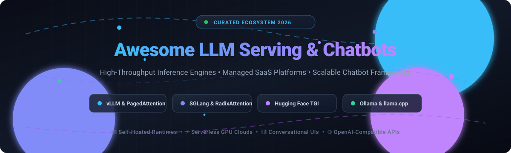
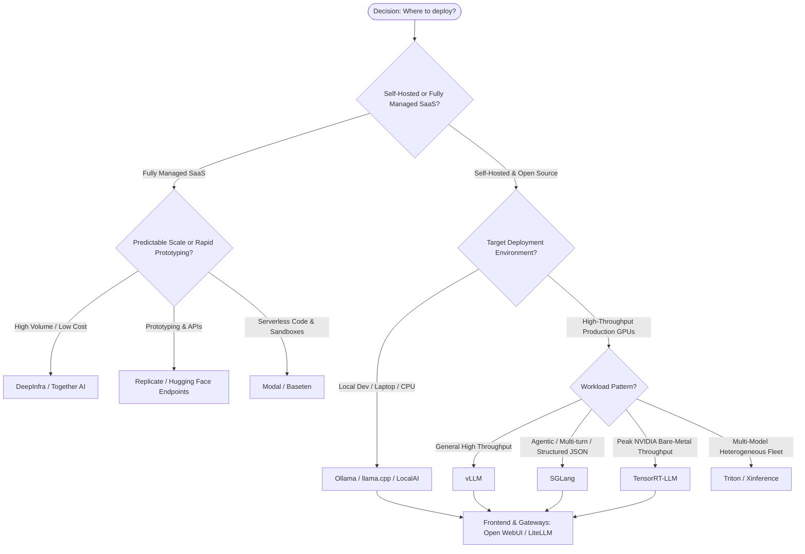

# 🚀 Awesome LLM Serving & Chatbots 🤖

**A definitive, SEO-optimized curated catalog of cutting-edge LLM serving engines, high-throughput GPU inference platforms, serverless APIs, and chatbot architectures.**

*Optimized for AI engineers, MLOps practitioners, and developers building scalable conversational intelligence and real-time LLM APIs.*

---

## 📌 Table of Contents

- [🌐 Sector Overview & Market Dynamics](#-sector-overview--market-dynamics)
- [☁️ SaaS & Hosted Inference Platforms](#️-saas--hosted-inference-platforms)
- [⚡ Open-Source Serving Engines & Chatbot Frameworks](#-open-source-serving-engines--chatbot-frameworks)
- [💡 Architectural Guide: Selecting Your Serving Stack](#-architectural-guide-selecting-your-serving-stack)
- [🤝 How to Contribute](#-how-to-contribute)
- [💖 Support & Sponsorship](#-support--sponsorship)
- [📈 Star History](#--star-history)
- [⚠️ Disclaimer](#️-disclaimer)

---

## 🌐 Sector Overview & Market Dynamics

The global AI inference and model serving market is projected to reach over $50B+ by the late 2020s, driven by rapid enterprise transition from model training to production inference and agentic chatbot deployment. The sector remains **moderately fragmented** between full-stack managed serverless platforms, specialized GPU cloud providers, and open-source self-hosted runtimes, though intense price-performance competition and standardizing runtime abstractions are gradually driving consolidation toward volume-advantaged providers and ecosystem leaders.

Key drivers include:
- **PagedAttention & KV Cache Optimization**: Enabling dramatic memory savings and continuous batching across high-concurrency workloads.
- **Speculative Decoding & Prefix Caching**: Minimizing time-to-first-token (TTFT) and decode latency for structured multi-turn agent dialogues.
- **Cost Arbitrage between SaaS vs. Self-Hosted**: Teams balancing raw developer agility against dedicated reservation economics at scale.

---

## ☁️ SaaS & Hosted Inference Platforms

The following table compares leading managed LLM serving providers and GPU serverless clouds, sorted descending by **Company Valuation / Scale**:

| Provider 🏢 | Valuation / Scale 📊 | Pricing Model & Starting Rates 💳 | Free Tier / Trial Limits 🎁 | Key Strengths & Use Cases 🎯 |
| :--- | :--- | :--- | :--- | :--- |
| **[Modal](https://modal.com/)** | **$15.75B** valuation ($1B+ ARR, Series D) | Pay-per-second serverless execution: CPU at $0.000014/core-sec, T4 GPU at $0.000164/sec (~$0.59/hr), A10G at $0.000306/sec (~$1.10/hr), A100 40GB at $0.000944/sec (~$3.40/hr), H100 at $0.001306/sec (~$4.70/hr). Egress $0.04/GiB. | **$30/month free compute credits** forever on the Starter Plan with credit card; $5/month testing allowance without credit card. Up to 3 workspace seats and 10 concurrent GPUs. | Best for teams needing unified Python-native serverless functions, batch jobs, and cold-start-optimized LLM serving. |
| **[Baseten](https://www.baseten.co/)** | **$13.0B** valuation (Series F) | Pay-per-second model serving: A10G at $0.000333/sec (~$1.20/hr), A100 80GB at $0.001083/sec (~$3.90/hr), H100 at $0.001944/sec (~$7.00/hr). Model APIs offer automated cached token discounts. | **$300 one-time credit** upon signup for testing and POC deployments. Startup program offers up to $25,000 for dedicated GPU inference. | Ideal for production agentic workloads that leverage prefix caching (system prompt and tool reuse). |
| **[Hugging Face Inference Endpoints](https://huggingface.co/inference-endpoints)** | **$12.9B** valuation (~$150M ARR) | Per-minute dedicated instance billing: CPU starting at $0.03/hr, NVIDIA T4 at $0.50/hr, L4 at $0.80/hr, A10G at $1.00/hr, L40S at $1.80/hr, A100 80GB at $2.50/hr. | **$0.10/month free credits** for serverless Inference Providers on free accounts; PRO tier ($9/mo) includes **$2.00/month recurring credits**. | Seamless one-click deployment directly from the Hugging Face Model Hub into isolated production endpoints. |
| **[Together AI](https://www.together.ai/)** | **$8.3B** valuation (~$1.15B ARR) | Serverless token inference starting at $0.18/M tokens (Llama-3-8B); Dedicated GPU clusters: H100 80GB at $5.49/hr, B200 180GB at $8.99/hr billed per ready replica/minute. | **No permanent free tier** (requires minimum initial prepayment of $5). Startup Accelerator Program provides $15,000 to $50,000 in compute credits for qualifying AI startups. | Highly optimized inference kernels; smooth transition path from serverless APIs to reserved dedicated GPU nodes. |
| **[Anyscale](https://www.anyscale.com/)** | **$1.65B** valuation (Acquired by Nscale) | Pay-as-you-go Ray compute: T4 at $0.5682/hr, L4 at $0.9542/hr, A10G at $1.3635/hr, A100 80GB at $4.9591/hr; H100 quote-based. | **$100 free trial credits** valid for 30 days upon new account activation. | Distributed Ray infrastructure for unified training, fine-tuning, batch offline inference, and real-time online serving. |
| **[RunPod](https://www.runpod.io/)** | **$1.0B** valuation (~$120M ARR) | Pay-per-second Flex/Active worker serverless: Community cloud GPUs starting at $0.20/hr, Secure Cloud A4000 at $0.34/hr, A5000 at $0.44/hr, RTX 4090 at $0.69/hr, H100 at $2.99/hr. | **$5 to $10 promotional signup credits** on new accounts; startup perks program offers up to $1,000 in free GPU/serverless credits. | Low per-second compute costs, instant cold-start flex workers, and flexible developer SDKs. |
| **[Replicate](https://replicate.com/)** | **$350M** valuation (Acquired by Cloudflare) | Pay-per-second inference billing: CPU starting at $0.000100/sec (~$0.36/hr), NVIDIA T4 at $0.000225/sec (~$0.81/hr), A40 (Large) at $0.000575/sec (~$2.07/hr), A100 80GB at $0.001400/sec (~$5.04/hr). | **$25 free trial credits** upon account registration for testing public models and API endpoints. | Massive open-source model directory and dead-simple REST API integrations without DevOps setup. |
| **[DeepInfra](https://deepinfra.com/)** | **$105M+ ARR** ($107M Series B raised) | Ultra-low per-token serverless billing: DeepSeek-V3/V4 at $0.14/M input and $0.28/M output (cached input $0.014/M); Llama-3-8B at $0.05/M input and $0.08/M output. | **No permanent free tier** (requires prepaying funds, minimum deposit $5). DeepStart Startup Program provides up to 50 billion free inference tokens for approved projects. | Extreme price-performance efficiency, transparent per-token metrics, SOC 2 / ISO 27001 certified. |
| **[Lepton AI](https://www.lepton.ai/)** | **$100M+ valuation** (Acquired by NVIDIA) | Serverless token inference starting at $0.20/M tokens (e.g. Llama 3 8B), dedicated nodes from $0.60/hr (L4) up to $4.50/hr (H100). | **Basic Free Tier** with lightweight testing sandbox + **$5 free trial credits** valid for 30 days upon signup. | Built by creator of Caffe/ONNX; lightweight Pythonic SDK for rapid local-to-cloud serverless deployments. |

---

## ⚡ Open-Source Serving Engines & Chatbot Frameworks

The table below catalogs premier open-source inference servers, local runtimes, and chatbot platforms, sorted descending by **GitHub_Stars_Count**:

| Project 🛠️ | GitHub_Stars 🌟 | Primary Focus & Architecture ⚙️ | Best Used For 🎯 |
| :--- | :--- | :--- | :--- |
| **[Ollama](https://github.com/ollama/ollama)** |  | Go-based lightweight daemon wrapping llama.cpp with automated model downloads, quantization management, and local OpenAI-compatible APIs. | Zero-setup local development, offline workstation inference, and local desktop chatbot backends. |
| **[Open WebUI](https://github.com/open-webui/open-webui)** |  | Full-featured, self-hosted responsive ChatGPT-like web interface with built-in RAG, web browsing, multi-modal support, RBAC, and Ollama/OpenAI API drivers. | Private enterprise chat portals, self-hosted ChatGPT replacements, and team AI workspaces. |
| **[llama.cpp](https://github.com/ggerganov/llama.cpp)** |  | Highly optimized C/C++ inference runtime for LLMs with GGUF quantization, SIMD acceleration, Apple Metal, SYCL, and CUDA backends. | Edge AI, CPU inference, consumer laptops, embedded devices, and cross-platform offline serving. |
| **[vLLM](https://github.com/vllm-project/vllm)** |  | High-throughput, memory-efficient LLM serving engine powered by PagedAttention, continuous batching, chunked prefill, speculative decoding, and multi-LoRA. | Enterprise high-concurrency production serving, maximum hardware utilization, and broad model compatibility. |
| **[LiteLLM](https://github.com/BerriAI/litellm)** |  | Universal proxy & AI gateway with Rust core and Python SDK; translates 100+ LLM APIs (OpenAI, Anthropic, Bedrock, Vertex, vLLM) into OpenAI format with unified rate limiting and cost tracking. | Centralized API gateway, fallback management, load balancing, and multi-provider observability. |
| **[LocalAI](https://github.com/mudler/LocalAI)** |  | All-in-one community self-hosted alternative to OpenAI APIs; handles text generation, audio transcription (Whisper), image generation, and embeddings without GPUs. | On-premises complete OpenAI API drop-in replacement across commodity hardware and homelabs. |
| **[FastChat](https://github.com/lm-sys/FastChat)** |  | LMSYS multi-model serving platform and evaluation harness; distributed controller-worker architecture with web UI and Chatbot Arena foundation. | Academic research, LLM benchmarking, multi-worker model hosting, and arena-style evaluations. |
| **[SGLang](https://github.com/sgl-project/sglang)** |  | High-performance inference engine featuring RadixAttention (automatic KV cache reuse across multiple requests) and fast structured decoding via compressed state machines. | Multi-turn agent workflows, complex structured output (JSON/regex schemas), and high-cache-hit chatbot applications. |
| **[TensorRT-LLM](https://github.com/NVIDIA/TensorRT-LLM)** |  | NVIDIA official state-of-the-art inference optimization toolkit compiling LLMs into TensorRT engines with in-flight batching and FP8/INT4 quantization. | Squeezing absolute peak inference throughput and lowest latency out of NVIDIA GPUs (H100/H200/B200). |
| **[OpenLLM](https://github.com/bentoml/OpenLLM)** |  | BentoML ecosystem runtime for packaging, containerizing, and orchestrating open-source models with Kubernetes and BentoCloud integrations. | Production MLOps pipelines requiring standard Bento packaging, CI/CD deployment, and auto-scaling. |
| **[Triton Inference Server](https://github.com/triton-inference-server/server)** |  | Enterprise-grade multi-framework model serving orchestrator by NVIDIA supporting PyTorch, ONNX, TensorRT, and TensorRT-LLM with dynamic batching. | Large-scale mission-critical enterprise microservices managing heterogeneous multi-model production fleets. |
| **[Hugging Face TGI](https://github.com/huggingface/text-generation-inference)** |  | Production-grade Rust and gRPC inference server engineered by Hugging Face; features continuous batching, token streaming, speculative decoding, and Docker delivery. | Battle-tested containerized deployments within the Hugging Face and Kubernetes enterprise ecosystem. |
| **[Xinference](https://github.com/xorbitsai/inference)** |  | Distributed cluster inference engine supporting LLMs, embedding models, image generators, and speech recognition with multi-node orchestration. | Unified cluster-wide management of diverse open-source multi-modal AI pipelines on-premise or in the cloud. |
| **[LMDeploy](https://github.com/InternLM/lmdeploy)** |  | High-efficiency compression and serving framework with the TurboMind C++ inference engine; excels in 4-bit KV cache and multi-modal Vision-Language Models. | Extreme memory compression, fast multi-modal inference (InternVL/LLaVA), and high-throughput batching. |

---

## 💡 Architectural Guide: Selecting Your Serving Stack

- **For Local Development & Desktop Assistants**: Choose **Ollama** paired with **Open WebUI** for an intuitive, battery-included desktop or team chat interface.
- **For High-Throughput Enterprise API Serving**: Use **vLLM** as the default workhorse engine or **SGLang** when prefix-heavy agent workflows and strict JSON schema generation are required.
- **For Heterogeneous Fleet & Cost Management**: Place **LiteLLM** as a proxy layer in front of all providers to enable automated failover, load balancing, and spend quotas.

---

## 🤝 How to Contribute

We actively welcome contributions from the community!

1. 🍴 **Fork the repository** to your GitHub account.
2. 🌿 **Create a descriptive branch**: `git checkout -b feature/add-new-serving-engine`.
3. 📝 **Add or update entries**: Ensure SaaS providers include verifiable pricing and trial limit details; ensure open-source repositories include accurate categorization.
4. 🧪 **Check formatting**: Maintain table structure and ensure all links are valid.
5. 🚀 **Submit a Pull Request** with a concise summary of the addition.

---

## 💖 Support & Sponsorship

If this curated guide saves you time or helps guide your organization's inference infrastructure decisions, please consider supporting the project:

- ⭐ **Star this repository** to help other engineers discover it.
- 🍴 **Fork and share** with your network, team, or Discord communities.
- ☕ **Sponsor the Maintainer**: Contributions help sustain open research, infrastructure benchmarking, and continuous updates.  
  👉 **[Sponsor on GitHub: https://github.com/sponsors/ishandutta2007](https://github.com/sponsors/ishandutta2007)**

---

##  Star History

---

## ⚠️ Disclaimer

- This is an **independently curated community list** compiled for educational, architectural, and technical evaluation purposes.
- **Hardware economics differ dramatically**: Managed dedicated instances (e.g. Together AI H100 at $5.49/hr or ~$3,950/month) vs. serverless per-token billing behave very differently under bursty vs. continuous traffic. Model your concurrency and usage profiles carefully before reserving capacity.
- Pricing, free tiers, and API policies are subject to provider updates over time. Please refer to each vendor's official pricing calculator for authoritative quotes.

---

**Crafted with ❤️ for AI Engineers, Platform Teams, and MLOps Architects.**  
*Accelerating open, throughput-efficient, and cost-effective LLM serving.*

